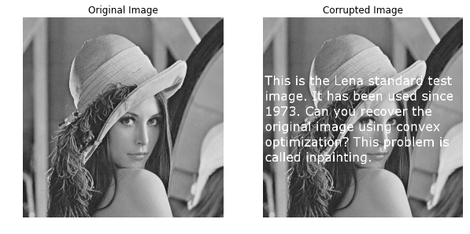
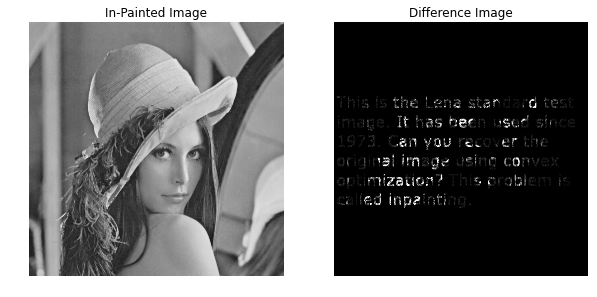
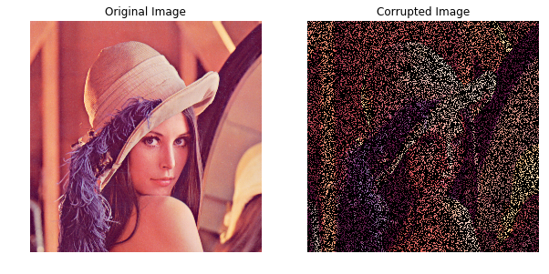
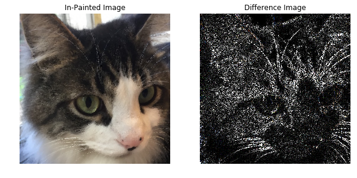

Total variation in-painting
===========================

Grayscale Images
----------------

A grayscale image is represented as an :math:`m \times n` matrix of
intensities :math:`U^\mathrm{orig}` (typically between the values
:math:`0` and :math:`255`). We are given the values
:math:`U^\mathrm{orig}_{ij}`, for :math:`(i,j) \in \mathcal K`, where
:math:`\mathcal K \subset \{1,\ldots, m\} \times \{1, \ldots, n\}` is
the set of indices corresponding to known pixel values. Our job is to
*in-paint* the image by guessing the missing pixel values, *i.e.*, those
with indices not in :math:`\mathcal K`. The reconstructed image will be
represented by :math:`U \in {\bf R}^{m \times n}`, where :math:`U`
matches the known pixels, *i.e.*, :math:`U_{ij} = U^\mathrm{orig}_{ij}`
for :math:`(i,j) \in \mathcal K`.

The reconstruction :math:`U` is found by minimizing the total variation
of :math:`U`, subject to matching the known pixel values. We will use
the :math:`\ell_2` total variation, defined as

.. math::

   \mathop{\bf tv}(U) =
   \sum_{i=1}^{m-1} \sum_{j=1}^{n-1}
   \left\| \left[ \begin{array}{c}
    U_{i+1,j}-U_{ij}\\ U_{i,j+1}-U_{ij} \end{array} \right] \right\|_2.

Note that the norm of the discretized gradient is *not* squared.

We load the original image and the corrupted image and construct the
Known matrix. Both images are displayed below. The corrupted image has
the missing pixels whited out.

.. code:: python

    import matplotlib.pyplot as plt
    import numpy as np
    
    # Load the images.
    u_orig = plt.imread("data/loki512.png")
    u_corr = plt.imread("data/loki512_corrupted.png")
    rows, cols = u_orig.shape
    
    # known is 1 if the pixel is known,
    # 0 if the pixel was corrupted.
    known = np.zeros((rows, cols))
    for i in range(rows):
        for j in range(cols):
             if u_orig[i, j] == u_corr[i, j]:
                known[i, j] = 1
    
    %matplotlib inline
    fig, ax = plt.subplots(1, 2, figsize=(10, 5))
    ax[0].imshow(u_orig, cmap='gray')
    ax[0].set_title("Original Image")
    ax[0].axis('off')
    ax[1].imshow(u_corr, cmap='gray');
    ax[1].set_title("Corrupted Image")
    ax[1].axis('off');

The total variation in-painting problem can be easily expressed in
CVXPY. We use the solver SCS, which scales to larger problems than ECOS
does.

.. code:: python

    # Recover the original image using total variation in-painting.
    import cvxpy as cp
    
    
    U = cp.Variable(shape=(rows, cols))
    obj = cp.Minimize(cp.tv(U))
    constraints = [cp.multiply(known, U) == cp.multiply(known, u_corr)]
    prob = cp.Problem(obj, constraints)
    
    # Use SCS to solve the problem.
    prob.solve(verbose=True, solver=cp.SCS)
    print("optimal objective value: {}".format(obj.value))

.. code:: python

    fig, ax = plt.subplots(1, 2, figsize=(10, 5))
    # Display the in-painted image.
    ax[0].imshow(U.value, cmap='gray');
    ax[0].set_title("In-Painted Image")
    ax[0].axis('off')
    
    img_diff = 10*np.abs(u_orig - U.value)
    ax[1].imshow(img_diff, cmap='gray');
    ax[1].set_title("Difference Image")
    ax[1].axis('off');

Color Images
============

For color images, the in-painting problem is similar to the grayscale
case. A color image is represented as an :math:`m \times n \times 3`
matrix of RGB values :math:`U^\mathrm{orig}` (typically between the
values :math:`0` and :math:`255`). We are given the pixels
:math:`U^\mathrm{orig}_{ij}`, for :math:`(i,j) \in \mathcal K`, where
:math:`\mathcal K \subset \{1,\ldots, m\} \times \{1, \ldots, n\}` is
the set of indices corresponding to known pixels. Each pixel
:math:`U^\mathrm{orig}_{ij}` is a vector in :math:`{\bf R}^3` of RGB
values. Our job is to *in-paint* the image by guessing the missing
pixels, *i.e.*, those with indices not in :math:`\mathcal K`. The
reconstructed image will be represented by
:math:`U \in {\bf R}^{m \times n \times 3}`, where :math:`U` matches the
known pixels, *i.e.*, :math:`U_{ij} = U^\mathrm{orig}_{ij}` for
:math:`(i,j) \in \mathcal K`.

The reconstruction :math:`U` is found by minimizing the total variation
of :math:`U`, subject to matching the known pixel values. We will use
the :math:`\ell_2` total variation, defined as

.. math::

   \mathop{\bf tv}(U) =
   \sum_{i=1}^{m-1} \sum_{j=1}^{n-1}
   \left\| \left[ \begin{array}{c}
    U_{i+1,j}-U_{ij}\\ 
    U_{i,j+1}-U_{ij} 
    \end{array} \right] \right\|_2.

Note that the norm of the discretized gradient is *not* squared.

We load the original image and construct the Known matrix by randomly
selecting 30% of the pixels to keep and discarding the others. The
original and corrupted images are displayed below. The corrupted image
has the missing pixels blacked out.

.. code:: python

    import matplotlib.pyplot as plt
    import numpy as np
    
    np.random.seed(1)
    # Load the images.
    u_orig = plt.imread("data/loki512color.png")
    rows, cols, colors = u_orig.shape
    
    # known is 1 if the pixel is known,
    # 0 if the pixel was corrupted.
    # The known matrix is initialized randomly.
    known = np.zeros((rows, cols, colors))
    for i in range(rows):
        for j in range(cols):
            if np.random.random() > 0.7:
                for k in range(colors):
                    known[i, j, k] = 1        
    u_corr = known * u_orig
    
    # Display the images.
    %matplotlib inline
    fig, ax = plt.subplots(1, 2, figsize=(10, 5))
    ax[0].imshow(u_orig, cmap='gray');
    ax[0].set_title("Original Image")
    ax[0].axis('off')
    ax[1].imshow(u_corr);
    ax[1].set_title("Corrupted Image")
    ax[1].axis('off');

We express the total variation color in-painting problem in CVXPY using
three matrix variables (one for the red values, one for the blue values,
and one for the green values). We use the solver SCS; the solvers ECOS
and CVXOPT don't scale to this large problem.

.. code:: python

    # Recover the original image using total variation in-painting.
    import cvxpy as cp
    
    
    variables = []
    constraints = []
    for i in range(colors):
        U = cp.Variable(shape=(rows, cols))
        variables.append(U)
        constraints.append(cp.multiply(known[:, :, i], U) == cp.multiply(known[:, :, i], u_corr[:, :, i]))
    
    prob = cp.Problem(cp.Minimize(cp.tv(*variables)), constraints)
    prob.solve(verbose=True, solver=cp.SCS)
    print("optimal objective value: {}".format(prob.value))

.. code:: python

    import matplotlib.pyplot as plt
    import matplotlib.cm as cm
    %matplotlib inline
    
    rec_arr = np.zeros((rows, cols, colors))
    for i in range(colors):
        rec_arr[:, :, i] = variables[i].value
    rec_arr = np.clip(rec_arr, 0, 1)
    
    fig, ax = plt.subplots(1, 2,figsize=(10, 5))
    ax[0].imshow(rec_arr)
    ax[0].set_title("In-Painted Image")
    ax[0].axis('off')
    
    img_diff = np.clip(10 * np.abs(u_orig - rec_arr), 0, 1)
    ax[1].imshow(img_diff)
    ax[1].set_title("Difference Image")
    ax[1].axis('off')

.. parsed-literal::

    (-0.5, 511.5, 511.5, -0.5)

